# Scenely

Learn a language by living it. Scenely drops you into short, real-life scenes, such as ordering a coffee, told only in the language you are learning. There are no translations: meaning comes from pictures, animation, repetition and your choices.

The first language is **Dutch (nl-NL)**. The app is built so that more languages can be added as data and themes, without engine changes.

## Screenshots

Taken on the iPhone 17 Pro simulator (Expo Go). The speaking exercise needs a development build, so it isn't shown here.

| Pick your avatar | Your town | Cycle to the next place |
|:---:|:---:|:---:|
| 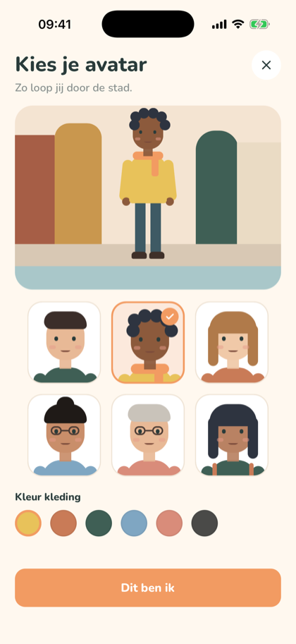 | 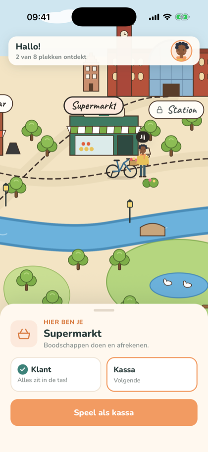 | 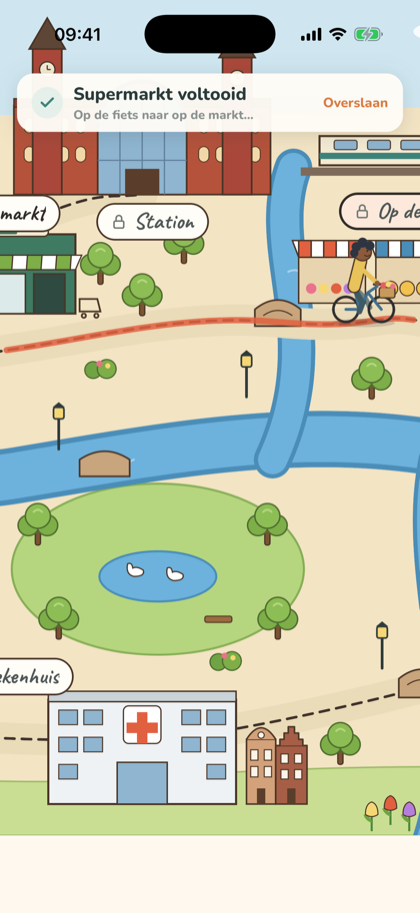 |
| **A scene** | **A right answer** | **Goed gedaan!** |
| 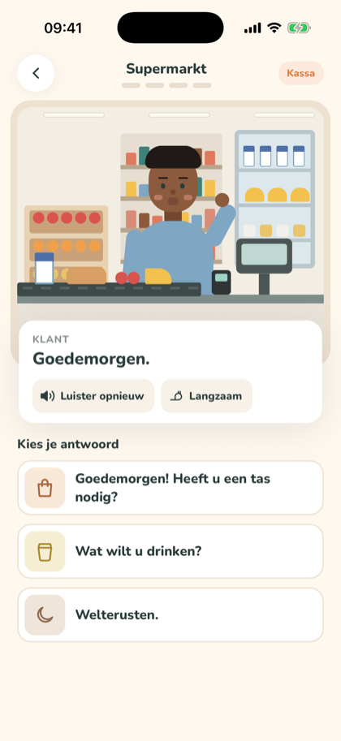 | 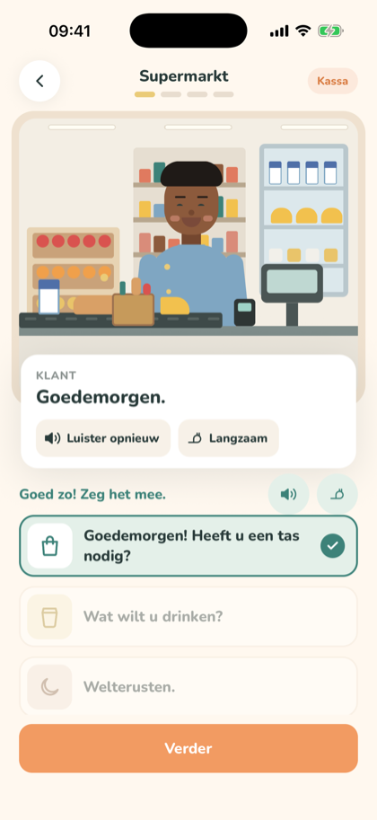 | 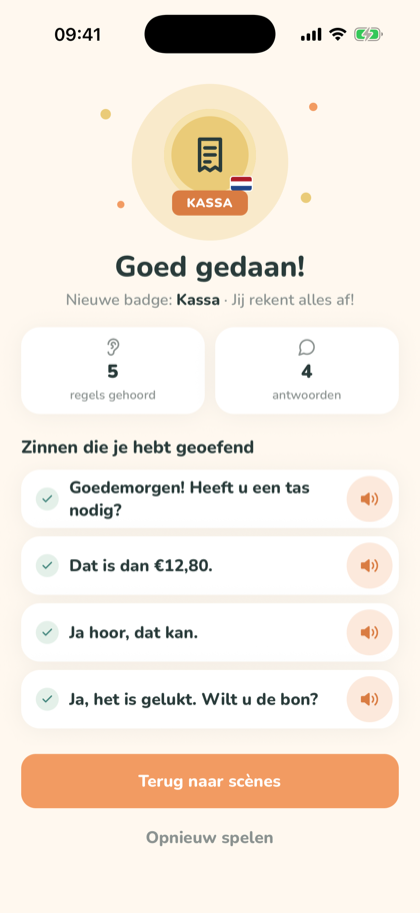 |

- **Avatar:** six looks and six outfit colours; your avatar rides the map in these colours.
- **Map:** a hand-drawn Amsterdam with eight places, each with two roles (16 scenes). Places open in order; finished ones get a check.
- **Ride:** when you finish a place, you cycle along the bike route to the next one.
- **Scene:** Dutch only. Listen, read the line, and pick what you would say. No translations.
- **Right answer:** the voice says your sentence so you can say it along; tap to hear it again, slowly.
- **Goed gedaan!:** your badge, what you heard and said, and every sentence to replay.

| Welcome | Your profile | Settings | Dark mode |
|:---:|:---:|:---:|:---:|
| 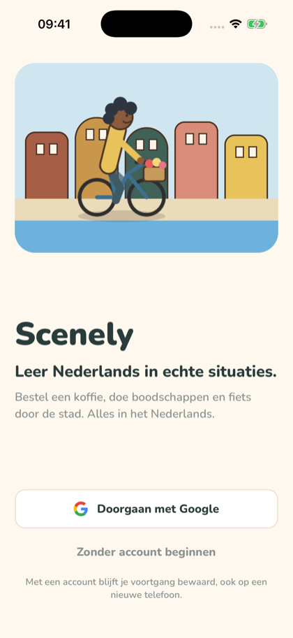 | 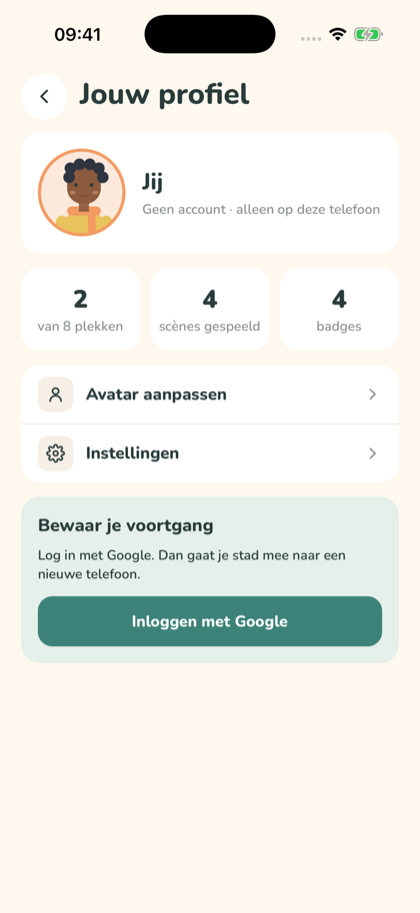 | 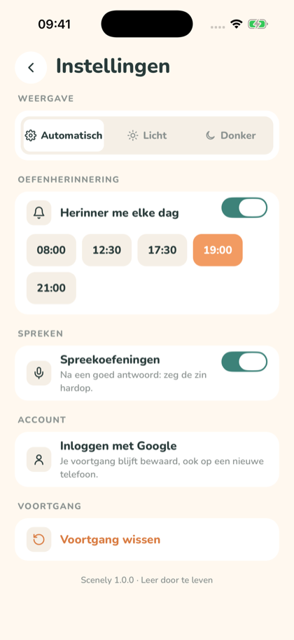 | 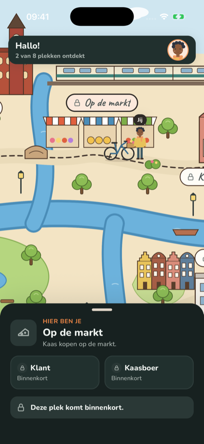 |

- **Welcome:** sign in with Google, or start without an account (progress then stays on the phone).
- **Profile:** your avatar, how far you are, and a way to sign in later so your town moves with you.
- **Settings:** light, dark or automatic; a daily reminder at a time you pick; speaking on or off; sign out, delete your account, or clear your progress.

## Status

| Milestone | State |
|---|---|
| Setup (Expo, TypeScript, expo-router, dependencies) | ✅ Done |
| Engine: types, pure reducer, progress and unlock rules, scene validation, tests | ✅ Done |
| Café scenes as data (customer and barista versions) | ✅ Done |
| Scene screen in the v7 design (Dutch café, dialog card, answer cards, progress dashes, Dutch speech) | ✅ Done |
| Illustrated Amsterdam map, avatar picker, avatar cycles to the next place, saved progress | ✅ Done |
| Speaking exercise ("Zeg het hardop") after each right answer | ✅ Done |
| Feedback (Lottie, sounds) | ⏳ Next |
| Scene completion screen ("Goed gedaan!": badge, counts, practised sentences) | ✅ Done |
| Supermarkt scenes (Klant, Kassa) at A1 and the curriculum map (`docs/curriculum-nl.md`) | ✅ Done |
| Accounts (Google via Firebase), profile, settings, light/dark theme, daily reminder, app icon and launch screen | ✅ Done |
| Map follows the time of day and the season | ✅ Done |
| Intro story: from the landing to the koffiebar | ✅ Done |
| All eight places playable: markt, kledingwinkel, huisarts, ziekenhuis, school and station (two roles each) | ✅ Done |
| Native-speaker review of the Dutch dialogue | ⏳ Open |
| Progress screens (badges, tab bar) | Planned |
| Polish (accessibility, reduce motion) | Planned |

Designs are in Figma (page "✅ v7 · Screens + speaking + UI flow"). The app follows the Visual design blueprint: one palette and the Nunito font for every language.

## Run it

Requirements: Node 20+ and the Expo Go app on your phone.

```bash
npm install
npx expo start
```

Scan the QR code with your phone's camera (iOS) or with Expo Go (Android).

**Speaking exercises need a development build.** They use `expo-speech-recognition`, which Expo Go doesn't contain. In Expo Go the app still runs; it just doesn't offer "Zeg het hardop". To try speaking on a phone, build the app once on your machine (or with EAS) and use that instead of Expo Go. In a desktop browser (Chrome), speaking works on the web version too.

```bash
npx expo run:ios      # or: npx expo run:android
```

On first launch you pick an avatar and watch the short intro story, then land on the map at the café. Tap **Speel als klant** to play. Progress is saved on the device, so **Barista** opens after Klant. Finishing both café roles makes your avatar cycle to the next place. In development, long-press a locked role to open it anyway.

**Dutch voice:** the app speaks with a Netherlands Dutch (`nl-NL`) voice. If no Dutch voice is installed, install one in your phone's settings:
- iOS: Settings → Accessibility → Spoken Content → Voices → Dutch → choose a Netherlands voice (Enhanced or Premium sounds best).
- Android: Settings → System → Languages → Text-to-speech output → Install voice data → Dutch (Netherlands).

## Checks

```bash
npm test            # Jest unit tests
npm run typecheck   # TypeScript strict mode
npx expo lint       # ESLint
```

## Project layout

```
src/
├── app/                 # expo-router screens (every file is a route)
│   ├── index.tsx        # map ("Kaart"): places, avatar, ride to the next place
│   ├── welcome.tsx      # sign in with Google or start without an account
│   ├── avatar.tsx       # "Kies je avatar"
│   ├── intro.tsx        # the intro story (once, or replayed from Profiel)
│   ├── profile.tsx      # "Jouw profiel"
│   ├── settings.tsx     # "Instellingen"
│   ├── scene/[id].tsx   # scene player; saves the completion
│   └── done/[id].tsx    # "Goed gedaan!" after a scene
├── components/          # ScenePlayer, CafeScene, AnswerCard, SpeakPanel, MicPermission, Button, Icon, shapes
│   ├── avatar/          # Figure (full-body person drawn from shapes), avatar looks
│   ├── intro/           # the five intro shots: drawings (art.ts), lines (shots.ts), animation (IntroStage)
│   └── map/             # Amsterdam map (generated data + SvgXml), place labels and sheet, cyclist
├── engine/              # pure logic: no UI, speech or storage
│   ├── types.ts         # Scene, Turn, Choice
│   ├── reducer.ts       # scene playback state machine
│   ├── selectors.ts     # question for a turn, tulip counts
│   ├── progress.ts      # unlock order, badges, tulip rating
│   ├── places.ts        # place status, where the avatar stands, when to ride
│   ├── speaking.ts      # compares what was said with the sentence, word by word
│   ├── summary.ts       # what a play-through covered, for "Goed gedaan!"
│   ├── result.ts        # passes a play-through to the completion screen
│   ├── validate.ts      # catches broken scene data
│   └── __tests__/
├── hooks/
│   ├── useGame.tsx      # saved progress and avatar, shared by all screens
│   ├── useScene.ts      # wires the reducer to speech and timing
│   ├── useSpeaking.ts   # one "say it out loud" attempt
│   ├── useAuth.tsx      # signed-in user, sign in and out
│   ├── useSettings.tsx  # saved settings, shared by all screens
│   ├── useScenery.ts    # time of day and season for the drawings
│   └── useVoice.ts      # finds the device voice for a language
├── services/
│   ├── speech.ts        # expo-speech wrapper: nl-NL voice, normal and slow rate
│   ├── listening.ts     # expo-speech-recognition wrapper (skipped where unavailable)
│   ├── firebase.ts      # Firebase app and auth
│   ├── googleSignIn.ts  # Google sign-in (native and web)
│   ├── cloud.ts         # Firestore sync of progress, avatar and settings
│   ├── settings.ts      # theme, reminder, speaking, map preview, intro seen
│   ├── reminders.ts     # daily local notification
│   └── storage.ts       # AsyncStorage: progress per language, avatar
├── scenes/
│   ├── index.ts         # unlock order per language
│   └── nl/              # Dutch scenes, one file per scene, and places.ts (the map's places)
└── themes/
    ├── types.ts         # colour and font tokens every language theme provides
    └── nl.ts            # Nederland theme
```

## The map follows your day and season

- The map uses the phone's clock and time zone: a pink dawn, a pale morning, a bright day, a golden evening, a purple dusk and a dark-blue night with stars. After dark the windows and street lamps light up. The sun (by day) or the moon (by night) crosses the sky, and the top card greets you with *Goedemorgen*, *Goedemiddag*, *Goedenavond* or *Goedenacht*.
- The season comes from the month and the time zone, so the southern hemisphere gets summer in December: blossom and petals in spring, orange trees and falling leaves in autumn, snow, white trees and icy canals in winter.
- **Settings → Kaart** can preview any time of day or season (Zonsopgang, Ochtend, Middag, Avond, Schemering, Nacht; Lente, Zomer, Herfst, Winter) or go back to *Automatisch*.
- How it works: `src/engine/scenery.ts` works out the time and season; `src/components/map/sceneryColors.ts` recolours the drawing's colours (season first, then the light of the day); `AmsterdamMap.tsx` adds the sun or moon, stars, snow, leaves and petals.

| Autumn evening | Winter night | Spring morning |
|:---:|:---:|:---:|
| 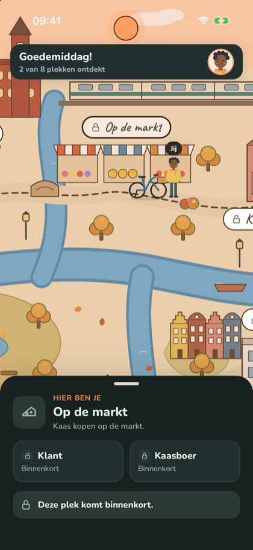 | 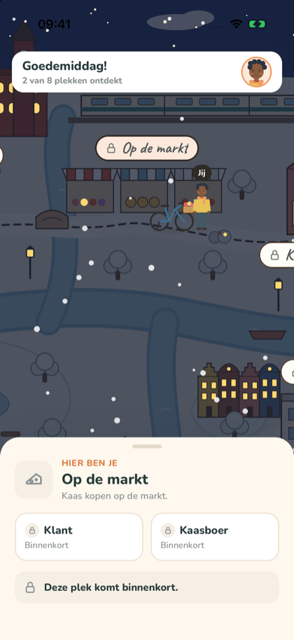 | 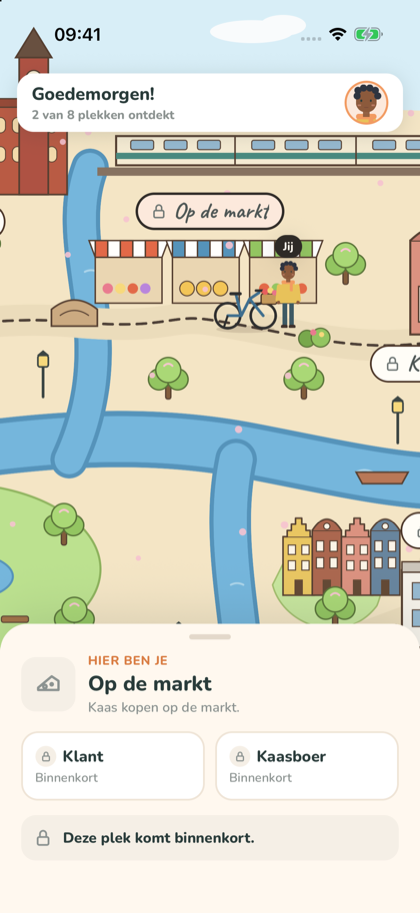 |

## The intro story

- It plays once, after you pick your avatar, in five shots: the plane lands over the bulb fields, *Welkom in Nederland* at the airport, the train over a canal bridge, cycling along a canal, and arriving at the koffiebar. **Beginnen** then opens the map.
- Each shot has a Dutch line that is read aloud (**Luister** repeats it). **Overslaan** skips the rest. Your own avatar is in every shot.
- The drawings follow the time of day and the season, like the map. The landing is always in spring, so the tulips are in bloom.
- With the phone's reduce-motion setting on, the shots are still pictures.
- **Profiel → Bekijk de intro opnieuw** replays it; this changes nothing and returns to Profiel.
- Everything is drawn in code (`src/components/intro/`) with react-native-svg and Reanimated. There is no video file.

## Accounts, settings and reminders

- **Accounts** use Firebase (project `scenely-eff51`) with Google sign-in. Signing in is optional: without an account everything is saved on the phone only. When you sign in, the phone and the account are merged (no progress is lost on either side; the account's avatar and settings win), and every change is saved to Firestore a moment later.
- **Setting up a copy:** copy `.env.example` to `.env.local` and fill in the Firebase web config and the Google client IDs. Put `GoogleService-Info.plist` and `google-services.json` from the Firebase console in `firebase/`. These files stay out of git. Paste `firestore.rules` into Firestore's Rules so each learner can only read and write their own `users/{uid}` document.
- **Google sign-in needs a development build** (`npx expo run:ios`, which needs Xcode 26.4+). In Expo Go the button explains that sign-in isn't available yet; on the web it uses Firebase's Google pop-up. Before an App Store release, Sign in with Apple must be added too (App Store rule for apps with third-party sign-in).
- **Theme:** Automatisch follows the phone; Licht and Donker override it. Screens use the theme's colours; the illustrations stay as drawn.
- **Daily reminder:** a local notification (no server) at 08:00, 12:30, 17:30, 19:00 or 21:00 with a short Dutch nudge. It needs the phone's permission, asked when you switch it on.
- **App icon and launch screen:** drawn in `scripts/build-icons.py` (a speech bubble with three canal houses on coral) and rendered with macOS's `sips`: `python3 scripts/build-icons.py`. Expo Go shows its own icon and splash; the real ones appear in a development or store build.

## How the scene screen behaves

- Top bar: back, the scenario title with one gold dash per answered question, and the role.
- The café sits in a frame; the other person's line is in a card below it, spoken with the best installed `nl-NL` voice (rate 0.9). **Luister opnieuw** repeats it; **Langzaam** plays it at rate 0.75.
- The answers appear with the question. A right answer turns teal with a tick ("Goed zo!"), the barista smiles and a coffee appears; **Verder** moves on. A wrong answer turns peach and shakes, the barista looks puzzled and repeats the question slowly, and the learner tries again.
- If no `nl-NL` voice is installed, the card asks the learner to install one; the text still shows.
- With the phone's reduce-motion setting on, the shake becomes a small offset.

## How speaking works

- After a right answer the learner can tap **Zeg het hardop**, or **Verder zonder spreken** to skip. It's never required.
- The first time, a screen explains why the microphone is needed; **Microfoon aanzetten** opens the system permission dialog, **Liever alleen luisteren** skips.
- On the speaking screen the learner can hear the sentence (**Voorbeeld**, **Langzaam**), then taps the microphone. Words turn teal as they are recognised (`nl-NL`, on the phone where the device supports it; nothing is saved).
- **Goed verstaan**: every word was heard. **Bijna**: the first missed word is underlined and can be played slowly; tap any word to hear it. **Probeer opnieuw** or **Verder**.
- Matching (`src/engine/speaking.ts`) ignores case, accents and punctuation, needs the words in order, and forgives one wrong letter in words of 4+ letters (two in 8+). Amounts like €2,50 match "2,50".

## How the map works

- Every place on the map is a scenario; its scenes (one per role) are listed in `src/scenes/nl/places.ts`, in riding order. A place with no scenes yet shows **Binnenkort**.
- A place is **open** when one of its scenes can be played, **done** when all are completed. The avatar stands at the first place that isn't done.
- After the last line, **Klaar** opens **Goed gedaan!**: the scene's badge ("Nieuwe badge" the first time), how many lines you heard, answers you gave and sentences you said out loud, and each sentence you chose with a replay button. **Terug naar scènes** returns to the map; **Opnieuw spelen** starts the scene again.
- When a completion finishes a place for the first time, the map plays the ride as soon as you are back on it: the stretch of bike route lights up red, your avatar cycles along it in their own colours (2.5 to 6 s, pedalling, turning to face the way they ride), parks the bike, and the new place's card opens marked **NIEUW**. **Overslaan** skips it; with the phone's reduce-motion setting on, the avatar is there at once.
- The map is a drawing in `assets/map/amsterdam-source.svg` (from the design canvas). `python3 scripts/build-amsterdam-map.py` turns it into `src/components/map/amsterdamMapData.ts`: the SVG without text or people, the bike route as points, and each place's stop on it. Place names are real labels on top (Caveat font), not part of the drawing.
- Progress is saved per language (`scenely/v1/progress/<lang>`); the avatar is shared (`scenely/v1/avatar`).

## How a scene works

A scene is a map of **turns**, starting from `start`:

- `npc`: the other character says a line (spoken, shown in a speech bubble), then moves to `next`.
- `player`: the learner picks a sticker. A correct choice moves to its `next`; a wrong one shows feedback and the learner tries again. More than one choice can be correct.
- `end`: the final line. Reaching it completes the scene.

The reducer (`src/engine/reducer.ts`) is a pure state machine with four actions: `START`, `CHOOSE`, `NEXT` and `RESTART`. Every choice is counted per turn and used for the tulip rating (3 = all first time).

## Add a scene

1. Create `src/scenes/nl/<scene-id>.ts` exporting a `Scene` (copy `koffiebar-klant.ts` as a starting point).
2. Add it to `scenesNl` in `src/scenes/index.ts`. Its position in that list is its unlock position.
3. Add its id to the right place's `sceneIds` in `src/scenes/nl/places.ts`.
4. Run `npm test`. The scene-data test runs `validateScene` on every scene and reports broken links, turns without a correct answer, and scenes whose end can't be reached.

**Content rules:** 4–8 turns, one goal, short A1–A2 sentences, one register per scene (formal `u` or informal `je`), no straight quotes (use “ ” and ’). Split a scenario into one scene per role only when the roles have different goals (customer vs barista). Friends or neighbours get one scene.

**Register in the café scenes:** both versions use formal `u`, because a café is a service setting.

## Add a language (later)

1. Add a theme in `src/themes/<lang>.ts` that implements `Theme`.
2. Add scenes under `src/scenes/<lang>/` with `language` set to the right BCP 47 code.
3. Speech picks a voice from each scene's `language`.

## Credits and licences

Only free assets with clear licences (CC0, MIT or OFL). Each asset's source is listed here.

| Asset | Source | Licence |
|---|---|---|
| Icons (`src/components/Icon.tsx`) | Drawn in the style of [Lucide](https://lucide.dev), some paths adapted from it | MIT |
| Font: Nunito | Google Fonts, via `@expo-google-fonts/nunito` | SIL Open Font License 1.1 |
| Café, characters, tulips, map, avatars | Drawn in code for this project | Original to this project |

Packages added beyond the original plan (approved): `react-native-svg` for icons and shapes, and `@expo-google-fonts/nunito` for the blueprint font. (`@expo-google-fonts/bricolage-grotesque`, `dm-sans` and `caveat` were for the v5 design and are no longer used.)
